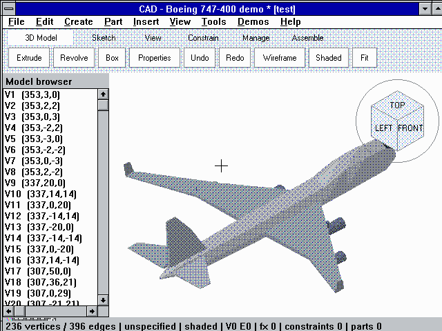

# win31c — CAD for Windows 3.1

An Inventor-style CAD application written in C for **Windows 3.1 (Win16, 80286)**,
cross-compiled on Linux/WSL with Open Watcom and run in the
[PCjs](https://www.pcjs.org/) IBM PC AT emulator.



## Features

- Ribbon (3D Model / Sketch / View), model browser and ViewCube with orbit ring
- Lines, XY rectangles, boxes and polygon extrusions with stable entity IDs
- Vertex grips (drag, snap, numeric properties), transactional undo/redo
- Versioned, CRC-checked `.CAD` documents with recoverable saves
- DXF (R12) and OBJ wireframe export; third-angle orthographic drawing sheet
- Demos: House, and a shaded/wireframe Boeing 747-400
- Parametric part modeling (Inventor-style feature tree):
  - **Sketch** tab / **Part** menu: *Start 2D Sketch* on XY, XZ or YZ with an offset
    expression (enters sketch mode, turns the view to the plane, dims other geometry),
    *Rectangle*, *Circle* (8..32 sides) and *Polygon* (`x,y;x,y;...`) profiles,
    *Finish Sketch*
  - **3D Model** tab: *Extrude* (sketch, profile ALL or number, distance, normal /
    reverse / symmetric) and *Revolve* (axis u or v, 12..24 segments)
  - Every dimension is an expression over Parameters (fx), e.g. `W/2 + 10`; features
    regenerate after each feature edit, parameter change, unit change, undo and load,
    so changing `W` resizes every extrusion that uses it
  - Browser group **Part** at the top: features and profiles with health markers
    `(!) message`, `(blocked)`, `(suppressed)`. Double-click/Enter edits (prefilled),
    Del removes (refused with an explanation while another feature depends on it);
    Part menu: Rename, Suppress/Unsuppress, Move Up/Down, Delete
  - An edit that would introduce a new error is rejected and the dialog stays open
  - Wireframe draws sketch curves blue and body edges black; *Shaded* fills feature
    bodies with the same orthographic renderer as the 747; Zoom all, DXF/OBJ export
    and the drawing sheet include body edges (within the 256/512 export limits; an
    omission count is reported)
  - Saved as a `[FEATURES]` section of the `.CAD` file (atomic load); feature edits
    mark the document dirty but are not model undo steps — *Part > Undo Last Feature
    Edit* reverts up to 4 of them

Limits: 256 vertices, 512 edges, integer coordinates ±400. Features: 24 features,
32 profiles (8 per sketch), regenerated output 1024 segments / 256 mesh vertices /
512 faces; the whole document extension (parameters, constraints, components,
features) must fit 16 KiB. Bodies are independent: no booleans, holes, fillets or
hidden-line removal; there is no solid kernel.

## Build

```sh
# One-off: install the pinned toolchain (see toolchain.lock.json) and mtools
mkdir -p ~/opt/openwatcom
curl -fL https://github.com/open-watcom/open-watcom-v2/releases/download/2026-10-01-Build/ow-snapshot.tar.xz \
  | tar -xJ -C ~/opt/openwatcom
sudo apt-get install mtools

sh build.sh cad          # -> out/cad.exe and out/disk.img (1.2 MB floppy)
```

`WATCOM=/path/to/openwatcom` overrides the toolchain location.

## Run and debug

`launch-debug.cmd` (Windows) or `./launch-debug.sh` (WSL) opens a local PCjs machine
in an app window. Wait for Program Manager, then **Mount latest A:** and **Launch CAD**.
**Capture mouse** gives the guest relative mouse input; Esc releases it.

You can also mount `out/disk.img` as drive A: on the public PCjs Windows 3.10 page
and run `A:\CAD.EXE` from Program Manager's File > Run.

## Tests

```sh
sh tests/run.sh                                   # host unit tests (C89, sanitizers)
sh tests/win16-check.sh                           # Watcom Win16 compile checks
python3 debug/test_generic_ui.py --windows --hold # visible end-to-end test in Edge
```

The end-to-end test drives the real Windows 3.1 guest, reading results from OCR and
a checksummed pixel strip that CAD.EXE draws in `/UITEST` mode.

## Layout

| Path | Purpose |
|---|---|
| `cad.c`, `cad.rc`, `cad_ui_ids.h` | Win16 front end |
| `cad_*.c/h` | Portable C89 modules (model, documents, export, drawing, sketch, params, constraints, assembly, features, aircraft, mesh view, ViewCube) |
| `cad_featureui.c/h` | Feature-tree glue for CAD.EXE: storage, dialogs, browser rows, persistence |
| `debug/` | Local PCjs harness, server and browser tests |
| `tests/` | Host tests and Win16 compile checks |
| `house.c`, `stars.c`, `wallgen.c` | Earlier experiments |

PCjs is © Jeff Parsons (MIT). Windows 3.1 disk images are fetched at runtime and are
not part of this repository.
